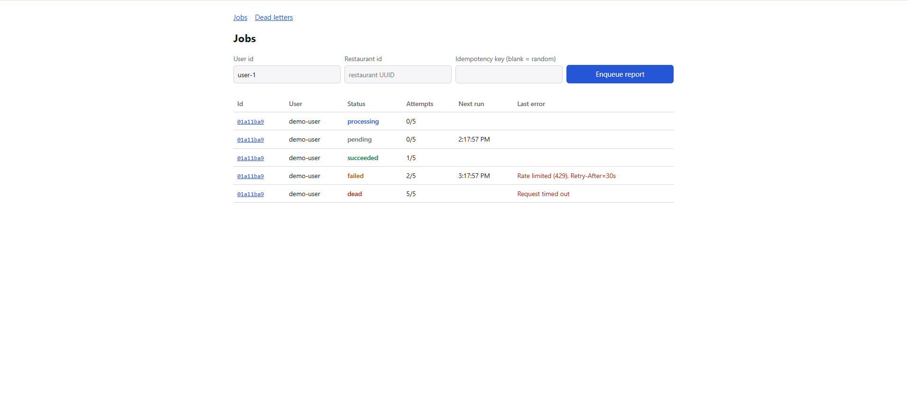
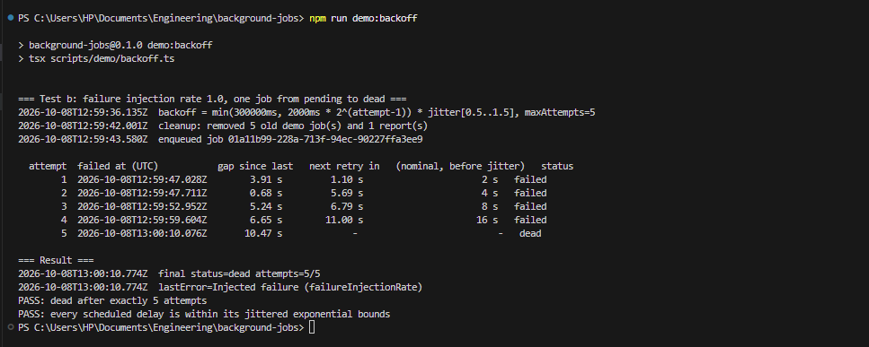
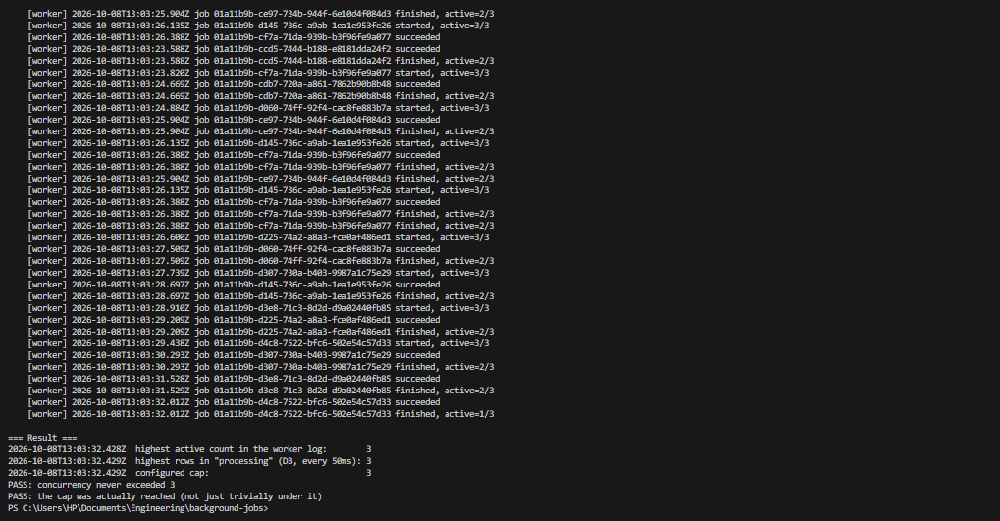
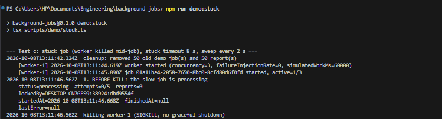
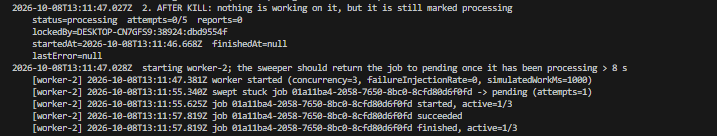
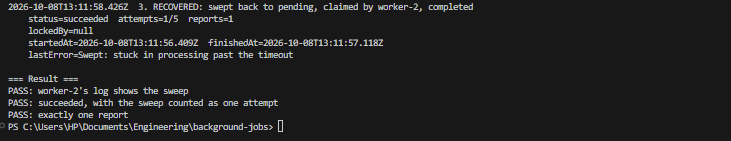

# background-jobs

A job system that moves slow, unreliable work off the request path, survives failure, and can prove what
happened to every job. The job type is `restaurant_report`: the worker calls the live food-market API,
walks every page of a restaurant's orders, and stores order count, revenue (minor units) and counts per
status.

Stack: Next.js (App Router), TypeScript, Prisma 7.10.0 (pinned), PostgreSQL, Zod, tsx.

## Setup

Requires Node 22+ and a PostgreSQL database.

```bash
npm install
cp .env.example .env        # then set DATABASE_URL yourself; never commit .env
npm run db:migrate          # applies prisma/migrations
```

If Prisma reports `P1001` against a database you can reach from Node, your machine's DNS may be blocking
Prisma's native engine. `npm run db:migrate` already goes through `scripts/with-resolved-db.mjs`, which
resolves the host with the OS resolver (see the sibling food-market-api BUILD_LOG.md, entry 8). The app and
worker use the `pg` driver adapter and are not affected.

## Run

Two processes, in two terminals:

```bash
npm run dev       # web app and API on http://localhost:3000
npm run worker    # the job worker
```

Pages: `/jobs` (enqueue form and live list), `/dead` (dead jobs with a retry button).

## API

| Method | Path | Notes |
| --- | --- | --- |
| POST | `/api/jobs` | Body `{ userId, restaurantId, idempotencyKey }`. Writes a pending row, returns 202 with the job id. Same key returns the existing job. 422 on a bad body. |
| GET | `/api/jobs/:id` | Status, attempts, lastError, timestamps, and the report when done. |
| GET | `/api/jobs?status=` | Newest first, up to 100. |
| POST | `/api/jobs/:id/retry` | Dead jobs only (409 otherwise). Resets attempts to 0. |

```bash
curl -X POST localhost:3000/api/jobs -H "content-type: application/json" \
  -d '{"userId":"user-1","restaurantId":"<restaurant-uuid>","idempotencyKey":"demo-1"}'
```

## How each requirement is met

| Requirement | How |
| --- | --- |
| Work off the request path | `POST /api/jobs` only inserts a `pending` row and returns 202. The worker is a separate process (`npm run worker`). |
| Idempotent enqueue | Unique constraint on `idempotencyKey`. A losing concurrent insert hits Prisma error P2002 and reads back the winner's row. |
| One claimant per job | One statement: `UPDATE ... WHERE id = (SELECT ... FOR UPDATE SKIP LOCKED LIMIT 1) RETURNING`. |
| Concurrency cap | `worker.concurrency`; a slot is reserved before the claim query. The active count is logged on every start and finish. |
| Retries | A failure increments `attempts`, stores `lastError`, sets `failed` and `runAt = now + min(cap, base * 2^(attempts-1)) * jitter`. |
| Dead letters | `attempts >= maxAttempts` sets `dead`. `/dead` shows type, payload, attempts, last error and timestamps, with a retry button. |
| Stuck jobs | A sweep on an interval returns jobs in `processing` longer than `stuckJobTimeoutMs` to `pending` (attempts + 1), or to `dead` if exhausted. |
| Idempotent work | The worker skips the work if a report for the job exists. `reports.jobId` is unique, and the report and the `succeeded` update are one transaction. Completion is guarded by `lockedBy`, so a worker whose job was swept cannot overwrite the new run. |
| Tunables | Every number is in [src/config.ts](src/config.ts). |

Status meanings: `failed` = the last attempt failed and a retry is scheduled at `runAt`; `dead` = attempts
exhausted, needs a human. The worker claims `pending` or `failed` jobs whose `runAt` has passed.

## Demos and tests

Each is `npm run demo:<name>`, prints timestamped output, and exits non-zero on failure. They start their
own worker processes, so **stop any worker you started yourself first**. They only touch rows whose
idempotency key starts with `demo-`, and refuse to run if real jobs are pending, failed or processing.
`idempotency` and `happy-path` also need `npm run dev` running.

**Simulated slow-work mode** (`worker.simulatedWorkMs` in `src/config.ts`: the work sleeps instead of calling
the live API, so its rate limit does not muddy a load test) was used by tests **a, c, e and f**. Test **b**
fails every attempt before any API call, so it needs no simulation. Test **d** and the happy path never use it:
the happy path calls the live API for real.

| Test | Command | What it shows | Result | Evidence |
| --- | --- | --- | --- | --- |
| Happy path | `demo:happy-path` | Enqueue over HTTP, worker calls the live API, report matches the API's own order total | pass | [happy-path.txt](evidence/happy-path.txt) |
| a. 50 jobs at once | `demo:concurrency` | Highest concurrent count is 3 with a cap of 3 | pass (after a fix) | [concurrency.txt](evidence/concurrency.txt), failing first run: [concurrency-before-fix.txt](evidence/concurrency-before-fix.txt) |
| b. Failure rate 1.0 | `demo:backoff` | One job through 5 attempts to dead; delays grow with jitter | pass | [backoff.txt](evidence/backoff.txt) |
| c. Stuck job | `demo:stuck` | Worker killed mid-job; the sweep recovers it; a new worker completes it | pass | [stuck.txt](evidence/stuck.txt) |
| d. Same key twice | `demo:idempotency` | In sequence and 25 simultaneous POSTs: exactly one row | pass | [idempotency.txt](evidence/idempotency.txt) |
| e. Two workers, 50 jobs | `demo:two-workers` | Each job claimed by exactly one worker (24 and 26); 50 reports for 50 succeeded | pass | [two-workers.txt](evidence/two-workers.txt) |
| f. Double run | `demo:double-run` | Work executed twice for one job id: one report; the database also rejects a second | pass | [double-run.txt](evidence/double-run.txt) |
| Screenshot data | `demo:all-statuses` | One job in each status, held steady | n/a | [all-statuses.txt](evidence/all-statuses.txt) |

Test a found a real bug on its first run (the cap was exceeded: 6 at once with a cap of 3). It is logged in
[BUILD_LOG.md](BUILD_LOG.md) entry 6, fixed, and the failing output is kept.

Limits worth knowing: the demos use a remote database, so each database round trip costs about a second and
the timestamps in the evidence include that. `createdAt` and `startedAt` come from the database clock while
`runAt` and failure times come from the worker's clock (see DECISIONS.md entry 20).

## Evidence

Screenshots, captured from the running app. To produce the data for the first one run
`npm run demo:all-statuses` and do not start a worker.

All statuses on `/jobs`:



Rows created by npm run demo:all-statuses; the natural lifecycle is shown by the backoff and stuck-job tests.

Backoff timestamps from `npm run demo:backoff`:



Concurrency cap from `npm run demo:concurrency`:



Stuck job, before the kill:



Stuck job, after the kill (still marked processing):



Stuck job, recovered by the sweep:



The dead letter page:


Design choices and their rejected alternatives: [DECISIONS.md](DECISIONS.md). Errors hit while building:
[BUILD_LOG.md](BUILD_LOG.md).
